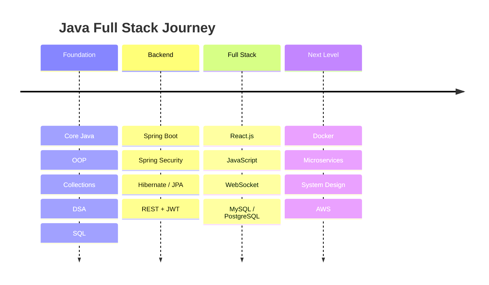

<div align="center">



<a href="https://github.com/KaranC-DEV">
  
</a>

<br/><br/>


<br/><br/>


</div>

<br/>


<div align="center">

## ⚡ ABOUT ME

</div>

```java
public class KaranChauhan implements FullStackDeveloper {

    private final String role      = "Java Full Stack Developer";
    private final String backend[] = {"Java", "Spring Boot", "Spring Security", "Hibernate / JPA"};
    private final String frontend  = "React.js + JavaScript";
    private final String data[]    = {"MySQL", "PostgreSQL"};
    private final String learning[] = {"Microservices", "System Design", "Docker & AWS"};
    private final String motto     = "Write clean code. Ship real products.";

    @Override
    public void code() {
        while (alive) {
            learn();
            build();
            test();
            deploy();
        }
    }
}
```

<div align="center">

| 🔭 Working on | 🌱 Learning | 🎯 Goal | ⚡ Fun fact |
|:---:|:---:|:---:|:---:|
| Real-time apps with Spring Boot + WebSocket | Microservices, System Design, Cloud | Become a strong Java Full Stack Engineer | I debug with coffee ☕ |

</div>


<div align="center">

## 🛠️ TECH ARSENAL &nbsp;·&nbsp; JAVA FULL STACK


</div>

<br/>

<div align="center">

| Layer | Technologies |
|:---:|:---|
| ☕ **Core Java** | `Java 8+` `OOP` `Collections` `Multithreading` `Streams & Lambda` `Exception Handling` `JDBC` `DSA` |
| 🌐 **Web (Java)** | `Servlets` `JSP` `Spring MVC` `REST APIs` `JSON` |
| 🍃 **Spring Ecosystem** | `Spring Boot` `Spring MVC` `Spring Security` `Spring Data JPA` `Hibernate` `JWT` `Lombok` `Validation` |
| 🎨 **Frontend** | `React.js` `JavaScript (ES6+)` `HTML5` `CSS3` `Bootstrap` `Axios / Fetch` |
| 🗄️ **Databases** | `MySQL` `PostgreSQL` `SQL & Joins` `Schema Design` `Indexing` |
| 🧪 **Build & Testing** | `Maven` `JUnit` `Mockito` `Postman` `Swagger / OpenAPI` |
| 🚀 **DevOps & Tools** | `Git` `GitHub` `Docker` |
| 💻 **IDEs** | `IntelliJ IDEA` `Eclipse` `VS Code` |
| 📡 **Real-Time** | `WebSocket` `STOMP` |

</div>

<br/>

<div align="center">


<br/>


</div>


<div align="center">

## 🚀 FEATURED PROJECTS

<a href="https://my-portfolio-ten-rose-99.vercel.app/">
  
</a>
<a href="https://github.com/KaranC-DEV/Online-Ticket-Booking-System">

</a>
<a href="https://github.com/KaranC-DEV/Connectify">

</a>
<a href="https://github.com/KaranC-DEV/Link-Forge">

</a>

</div>

<div align="center">

<a href="https://github.com/KaranC-DEV?tab=repositories">

</a>

</div>


<div align="center">

## 📊 GITHUB ANALYTICS


<br/>


</div>


<div align="center">

## 🏙️ FULL STACK CITY


</div>


<div align="center">

## 🐍 CONTRIBUTION SNAKE


</div>


<div align="center">

## 🗺️ MY ROADMAP

</div>




<div align="center">

## 🤝 LET'S CONNECT

<a href="https://github.com/KaranC-DEV">

</a>
<a href="https://www.linkedin.com/in/karanchauhan-dev/">

</a>
<a href="mailto:chauhankaran2106@gmail.com">

</a>

<br/><br/>


<br/>


</div>
