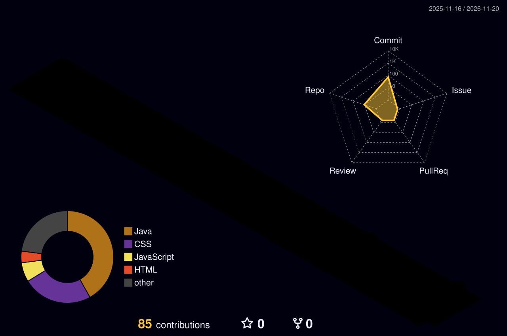
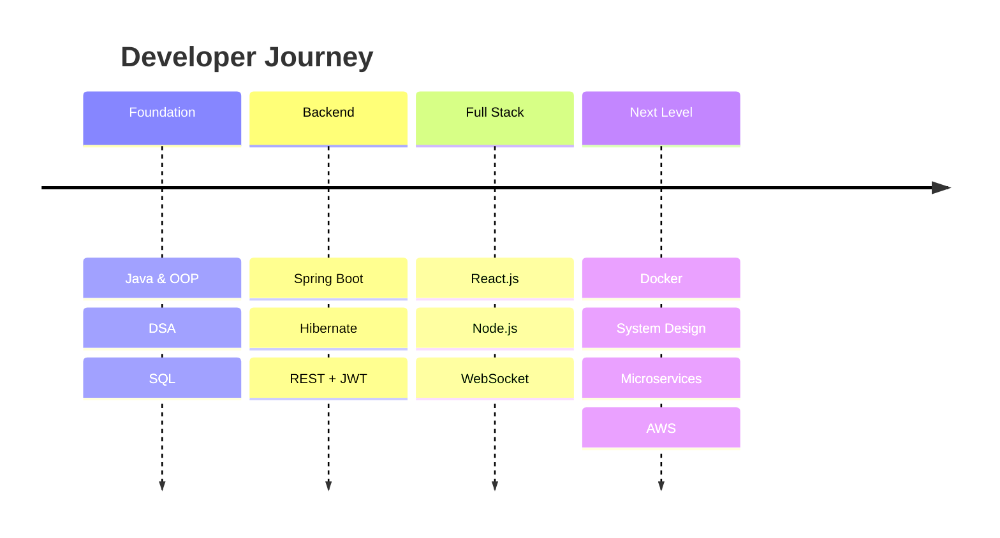

<div align="center">


<a href="https://github.com/KaranC-DEV">
  
</a>

<br/><br/>


<br/><br/>


</div>

<br/>


<div align="center">

## 🧊 3D CORE



</div>


<div align="center">

## ⚡ ABOUT ME

</div>

```java
public class KaranChauhan implements Developer {

    private final String role        = "Java Backend Developer";
    private final String stack[]     = {"Spring Boot", "Hibernate", "React", "PostgreSQL"};
    private final String currently   = "Building real-time & scalable applications";
    private final String learning[]  = {"System Design", "Microservices", "Docker & Cloud (AWS)"};
    private final String motto       = "Write clean code. Ship real products.";

    @Override
    public void code() {
        while (alive) {
            learn();
            build();
            deploy();
            repeat();
        }
    }
}
```

<div align="center">

| 🔭 Working on | 🌱 Learning | 🎯 Goal | ⚡ Fun fact |
|:---:|:---:|:---:|:---:|
| Real-time chat systems with WebSocket | System Design, Microservices, Cloud | Become a strong Backend Engineer | I debug with coffee ☕ |

</div>


<div align="center">

## 🛠️ TECH ARSENAL

</div>

<div align="center">

### ☕ Backend


### 🎨 Frontend


### 🗄️ Databases


### 🧰 Tools & DevOps


</div>

<br/>

<div align="center">

| Category | Technologies |
|:---:|:---|
| 🧠 **Languages** | `Java` `JavaScript` `Python` `SQL` |
| ⚙️ **Backend** | `Spring Boot` `Spring Security` `Hibernate / JPA` `JDBC` `Servlets` `Node.js` `Express` |
| 🎨 **Frontend** | `React.js` `HTML5` `CSS3` `Tailwind` |
| 🗄️ **Databases** | `MySQL` `PostgreSQL` `MongoDB` |
| 🔐 **Concepts** | `REST APIs` `JWT Auth` `WebSocket` `OOP` `MVC` `DSA` |
| 🧰 **Tools** | `Git` `GitHub` `Docker` `Postman` `IntelliJ IDEA` |

</div>


<div align="center">

## 🚀 FEATURED PROJECTS

<a href="https://github.com/KaranC-DEV/Real-Time-Chat-App">

</a>
<a href="https://github.com/KaranC-DEV/Online-Ticket-Booking-System">

</a>
<a href="https://github.com/KaranC-DEV/Connectify">

</a>
<a href="https://github.com/KaranC-DEV/Link-Forge">

</a>

</div>

<div align="center">

<a href="https://github.com/KaranC-DEV?tab=repositories">

</a>

</div>


<div align="center">

## 📊 GITHUB ANALYTICS


<br/>


</div>


<div align="center">

## 🧊 3D CONTRIBUTION CITY



</div>


<div align="center">

## 🏆 TROPHY CABINET


</div>


<div align="center">

## 🐍 CONTRIBUTION SNAKE


</div>


<div align="center">

## 🗺️ MY ROADMAP

</div>




<div align="center">

## 🤝 LET'S CONNECT

<a href="https://github.com/KaranC-DEV">

</a>
<a href="https://www.linkedin.com/in/YOUR-LINKEDIN-ID">

</a>
<a href="mailto:YOUR_EMAIL@gmail.com">

</a>
<a href="YOUR_PORTFOLIO_URL">

</a>

<br/><br/>


</div>
